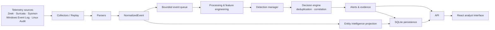

<!--
  ArgusProwl README
  Keep product claims aligned with the shipped code and deployment defaults.
-->

<div align="center">


# ArgusProwl

### Host-based threat detection · Evidence-led investigation · Local-first operations

[](https://www.python.org/)
[](LICENSE)
[](#project-maturity)
[](.github/workflows/backend-ci.yml)
[](.github/workflows/frontend-ci.yml)

**Turn endpoint and network telemetry into explainable detections, correlated alerts, and investigation context.**

ArgusProwl is an open-source security monitoring and investigation platform with a FastAPI backend and React analyst interface. It normalizes supported telemetry, evaluates configurable detections, correlates activity, and presents alerts with the evidence available to the pipeline.

[Quick start](#quick-start) · [Capabilities](#capabilities) · [Architecture](#architecture) · [Security](#security-and-operational-boundaries) · [Development](#development)

</div>

---

## What it does

ArgusProwl is designed around an analyst workflow:

1. **Ingest** supported host and network telemetry through configured collectors or replay historical logs.
2. **Normalize** source-specific records into a common event model.
3. **Analyze** events with configurable rules, behavioral baselines, and bounded temporal logic.
4. **Correlate** related observations and create deduplicated alerts.
5. **Investigate** alerts through evidence, entities, incidents, IOCs, and ATT&CK context.
6. **Operate** the platform through its local web interface, API, CLI, and persistent SQLite storage.

The platform is intended to make detection decisions inspectable. Behavioral scores and rule matches are investigative signals; they are not proof that an event is malicious.

## Capabilities

| Area | Current capability |
| --- | --- |
| Analyst experience | React dashboard, alert search and details, IOC lookup, evidence search, incidents, entities, and rule management |
| Detection | YAML-configured rules, normalized-event evaluation, behavioral baselines, temporal/periodicity analysis, deduplication, and correlation |
| Telemetry support | Parser and collector support for Zeek, Suricata, Sysmon, Windows Event Log, and Linux Audit; source availability and permissions are platform-dependent |
| Historical analysis | Replay supported log files through the production ingestion and detection path |
| Entity intelligence | Indexed SQLite projection of hosts, users, processes, IPs, domains, files, hashes, and evidence-backed relationships |
| Alert delivery | Pluggable alert-provider boundaries; availability depends on the configured provider |
| API security | API-key authentication, browser sessions, viewer/analyst/admin roles, key revocation, and durable audit records |
| Storage operations | SQLite diagnostics, consistent backups, restore verification, and tamper-evident audit-chain checkpoints |
| ATT&CK context | Optional enrichment from a separately installed, versioned ATT&CK snapshot |

### Important deployment distinction

The standard Docker Compose deployment packages the **web application and API** in one container. It does not bundle a host sensor, packet-capture service, log forwarder, message broker, or external telemetry data lake. Configure and deploy telemetry sources separately; collectors are not all enabled by default.

## Architecture

The system separates source-specific ingestion from normalized event processing and analyst-facing services.



**Key boundaries**

- Parsers translate source records; detectors consume normalized events rather than vendor-specific payloads.
- The decision engine owns final alert creation, deduplication, and correlation.
- Entity intelligence is a derived, indexed SQLite projection over canonical telemetry evidence; it is not a separate graph database.
- Queues and temporal state are bounded. Bounded processing protects the service from unbounded memory growth, but it also means operators must monitor queue pressure and loss counters.
- SQLite is the default local persistence backend. The PostgreSQL adapter has a dedicated integration path; other architecture references may describe planned or incomplete adapters.

For implementation detail, see [Architecture](docs/architecture.md), [Persistence guarantees](docs/persistence-guarantees.md), and [Single-process deployment](docs/single-process.md).

## Quick start

### Option A — Docker Compose

**Requirements:** Docker Engine and the Docker Compose plugin.

Compose enables API authentication. Set an administrator key before starting the container:

```bash
git clone https://github.com/HarshilBhuva/ArgusProwl.git
cd ArgusProwl

export ARGUSPROWL_API_KEY="$(openssl rand -hex 32)"
docker compose up --build -d
```

Open [http://localhost:8080](http://localhost:8080) and sign in with the API key generated in the same terminal session.

Useful operations:

```bash
# Follow application logs
docker compose logs -f argusprowl

# Check container health
docker compose exec argusprowl python -m argusprowl health

# Stop containers while preserving named data volumes
docker compose down
```

The Compose file binds the published port to host loopback and persists application data and logs in named volumes. **Do not use `docker compose down -v` unless you intend to delete that persisted state.**

If you do not provide `ARGUSPROWL_API_KEY`, the authentication bootstrap flow is available. Follow [First-run administrator bootstrap](docs/security.md#first-run-administrator-bootstrap) and keep the initial listener loopback-only.

### Option B — Local development

**Requirements:** Python 3.13+, [uv](https://docs.astral.sh/uv/), Node.js 22+, and npm.

```bash
git clone https://github.com/HarshilBhuva/ArgusProwl.git
cd ArgusProwl

# Install the locked Python environment
uv sync --frozen

# Build the React application served by FastAPI
cd frontend
npm ci
npm run build
cd ..

# Start the API and UI
uv run argusprowl server
```

Open [http://localhost:8080](http://localhost:8080). The local default configuration has API-key authentication disabled; do not expose that development configuration to an untrusted network. For the full detection engine and configured collectors, use:

```bash
uv run argusprowl start
```

The API's interactive documentation is available at [http://localhost:8080/docs](http://localhost:8080/docs).

## CLI operations

The CLI supports configuration validation, health checks, historical replay, and SQLite operations.

```bash
# Validate configuration
uv run argusprowl validate-config

# Check application health
uv run argusprowl health

# Replay a supported Zeek log file
uv run argusprowl replay /path/to/conn.log

# Inspect SQLite storage
uv run argusprowl storage stats
uv run argusprowl storage check
```

SQLite backup and audit-checkpoint commands are also available:

```bash
# Create a consistent database backup and manifest
uv run argusprowl backup create --output /safe/path/argusprowl.db

# Verify a backup before restore
uv run argusprowl backup verify /safe/path/argusprowl.db

# Create or verify an external audit-chain checkpoint
uv run argusprowl audit-checkpoint create --output /safe/path/audit-checkpoint.json
uv run argusprowl audit-checkpoint verify /safe/path/audit-checkpoint.json
```

Use `uv run argusprowl --help` and each subcommand's `--help` for the current options. Restore is an offline operation and requires explicit confirmation; read the [storage and persistence documentation](docs/persistence-guarantees.md) before performing it.

## Configuration

The default configuration is `config/default.yaml`. Use `--config <path>` to select an alternate file.

Environment variables use the `TH_` prefix; nested settings use double underscores:

```bash
# Example: change the API port
export TH_API__PORT=9090

# Example: enable API-key authentication for a local run
export TH_API__AUTH_ENABLED=true
```

Review collector paths, operating-system permissions, polling intervals, queue bounds, retention, and storage settings before enabling telemetry sources. A parser or configuration section being present does not mean its collector is active.

### Optional MITRE ATT&CK enrichment

The ATT&CK snapshot is not bundled in the repository or Docker image. Install the versioned snapshot for local development with:

```bash
uv run python scripts/download_attck_snapshot.py
```

The installer verifies the downloaded artifact before writing it to ignored local data storage. For Docker, install and mount/configure the snapshot separately if enrichment is required. ATT&CK materials are subject to [MITRE's terms of use](https://attack.mitre.org/terms-of-use/).

## Security and operational boundaries

ArgusProwl is **Alpha software**. Evaluate it with representative telemetry in a controlled environment before relying on it for production monitoring.

- **Authentication:** local default configuration has authentication disabled for development compatibility. Docker Compose enables it. Use unique, high-entropy credentials and named role-bearing keys for multi-operator deployments.
- **Authorization:** named credentials support `viewer`, `analyst`, and `admin` roles. Authorization is deny-by-default; the legacy single API key is administrator-level. See [Security and API access](docs/security.md).
- **Network exposure:** Compose publishes the service on host loopback. For remote access, use a properly configured TLS reverse proxy, network restrictions, and least-privilege credentials. Do not expose the first-run bootstrap endpoint publicly.
- **Sensitive telemetry:** events may contain hostnames, usernames, IP addresses, process details, and other sensitive data. Restrict access to the API, volumes, backups, and configuration.
- **Evidence retention:** some processing state is bounded and in-memory. Do not assume every raw event or intermediate observation is retained indefinitely. Review [Persistence guarantees](docs/persistence-guarantees.md) and configure retention/backups for your operational needs.
- **Queue behavior:** bounded queues can reject events under pressure. Monitor authenticated health diagnostics and investigate nonzero loss/error counters.
- **No autonomous response:** ArgusProwl is a monitoring and investigation platform. Do not interpret a detection as authorization to block, isolate, or remediate a host automatically.

Report vulnerabilities privately according to [SECURITY.md](SECURITY.md).

## Development

### Backend

```bash
uv sync --frozen
uv run python -m compileall -q src tests scripts
uv run ruff check src tests
uv run pytest -q
uv run python -m argusprowl validate-config
```

### Frontend

```bash
cd frontend
npm ci
npx tsc --noEmit -p tsconfig.app.json
npx vitest run
npm run lint
npm run build
```

### Docker

```bash
docker compose config -q
docker compose up --build
```

CI workflows define the authoritative automated checks: [Backend CI](.github/workflows/backend-ci.yml) and [Frontend CI](.github/workflows/frontend-ci.yml). A README-only change does not modify application code or dependencies.

## Repository layout

```text
config/                  Default application and detection configuration
docs/                    Architecture, security, replay, testing, and operations
frontend/                React + TypeScript analyst interface
scripts/                 Snapshot installation and development utilities
src/argusprowl/           Python API, ingestion, detection, decision, and storage
tests/                   Backend unit and integration tests
Dockerfile                Multi-stage application image
docker-compose.yml        Single-container UI/API deployment
pyproject.toml            Python package and tooling configuration
uv.lock                   Locked Python dependencies
```

## Documentation

| Guide | What it covers |
| --- | --- |
| [Architecture](docs/architecture.md) | Components, normalized events, data flow, and entity intelligence |
| [Security and API access](docs/security.md) | Bootstrap, credentials, roles, sessions, revocation, and audit trail |
| [Persistence guarantees](docs/persistence-guarantees.md) | Durable records, retention, backups, and recovery boundaries |
| [Replay](docs/replay.md) | Offline replay semantics and validation |
| [Testing](docs/testing.md) | Unit, integration, replay, and regression test expectations |
| [PostgreSQL storage](docs/postgresql-storage.md) | PostgreSQL adapter and integration notes |
| [Productization](docs/productization.md) | Product scope and deployment considerations |
| [Contributing](CONTRIBUTING.md) | Contribution workflow and repository standards |

## Project maturity

ArgusProwl is under active development and currently in **Alpha**. APIs, configuration, detection behavior, and deployment details can change between revisions. The repository's tests and documentation describe the current implementation; they should not be read as a claim of production certification or complete telemetry coverage.

## License

Apache-2.0. See [LICENSE](LICENSE).
