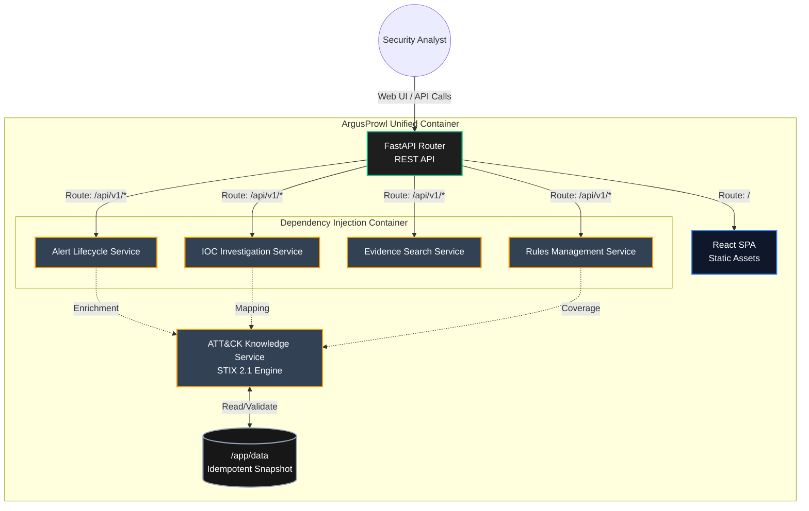

# ArgusProwl


ArgusProwl is a full-stack threat hunting and SOC analysis interface. It maps security observables to the MITRE ATT&CK® framework and provides analysts with a streamlined, alert-based investigation workflow.

Beyond its functional capabilities, this project serves as a showcase of modern software architecture, strict Dependency Injection (DI), zero-friction containerization, and rigorous DevSecOps practices.

---

## 🛠️ Technology Stack & Architecture

ArgusProwl is built using a modern, decoupled stack focused on maintainability and security.

| Domain | Technologies Used |
|---|---|
| **Backend API** | Python 3.13, FastAPI, Strict Dependency Injection, `uv` package manager |
| **Frontend UI** | Node.js, React, TypeScript |
| **Core Services** | Alert Lifecycle Management, IOC Investigation, Evidence Search, Rule Evaluation |
| **Threat Intel** | MITRE ATT&CK STIX 2.1 Engine (Native JSON parsing) |
| **DevSecOps** | GitHub Actions, Docker (Multi-stage), Trivy, Bandit, Ruff, Pytest (2,500+ tests) |

---

## 🚀 Engineering Highlights

This repository demonstrates advanced software engineering patterns designed for security, scalability, and an elite developer experience:

* **Enterprise-Grade Dependency Injection:** The backend logic is entirely decoupled using a rigorous DI container. This allows the API routing layer to remain completely stateless while core services (Alerts, IOCs, Rules) are easily mocked, leading to a massive, highly resilient **2,500+ unit and integration test suite**.
* **Zero-Friction, Unified Deployment:** The Node.js frontend and Python backend are compiled via a multi-stage Dockerfile into a single, immutable container. FastAPI directly serves the statically compiled React assets, entirely eliminating CORS complexity and proxy overhead.
* **Optional ATT&CK enrichment:** Enterprise ATT&CK data is installed locally by the operator and is not bundled in the source repository or Docker image.
* **Strict DevSecOps Pipeline:** The CI/CD pipeline enforces extreme code quality and supply-chain security:
  * Static Application Security Testing (SAST) via **Bandit**.
  * Container vulnerability scanning via **Trivy**, configured to fail the build on critical/high CVEs.
  * Deterministic dependency resolution via `uv`.

### 🧠 Internal System Architecture

The following diagram illustrates the decoupled, service-oriented architecture operating inside the unified Docker container.



---

## Key Features

- **C2 & beacon detection** — dedicated `TlsC2Detector` and `BeaconingDetector` analyze periodicity, inter-arrival jitter, and TLS fingerprint heuristics.
- **Temporal & periodicity analysis** — sliding-window baselines and periodicity detection (default threshold: `0.7`) for C2 flagging.
- **Multi-source telemetry** — normalized collectors for **Zeek**, **Suricata**, **Sysmon**, **Windows Event Log**, and **Linux audit** feeds.
- **ATT&CK enrichment** — knowledge service maps detections to MITRE ATT&CK tactics and techniques.
- **Configurable YAML rule engine** — severity, confidence, cooldown, and alert-rate caps declared per rule.
- **REST API** — FastAPI application exposing detection and system resources.
- **Replay engine** — offline replay of log files through the full detection pipeline.

---

## Getting Started

### Prerequisites

- **Python 3.13+**
- **uv** (package manager)

### Installation

```bash
# Clone the repository
git clone <repo-url> argusprowl
cd argusprowl

# Sync dependencies
uv sync
```

---

## Running the Application

The CLI entry point `argusprowl` (invokable via `python -m argusprowl` or `uv run argusprowl`) supports several subcommands:

### Start the Detection Engine

```bash
uv run argusprowl start
```

Loads configuration, wires the DI container, and starts the ingestion/processing loop. The FastAPI server (if enabled) runs in the foreground.

### Start API Server Only

```bash
uv run argusprowl server
```

Boots only the HTTP API (requires `api.enabled: true` in your config).

### Run a Health Check

```bash
uv run argusprowl health
```

Prints the overall status and per-component health of the application.

### Replay a Log File (e.g., Zeek conn.log)

```bash
uv run argusprowl replay /path/to/zeek.log
```

Deterministically re-processes historical telemetry through the detection pipeline.

### Validate Configuration

```bash
uv run argusprowl validate-config
```

---

## Configuration

Configuration is YAML-based. The default file lives at `config/default.yaml`.

All subcommands accept `--config <path>` to point at a different file.

### Overriding via Environment Variables

Key settings can be overridden through environment variables using the `TH_` prefix. For example, to override the API port:

```bash
export TH_API__PORT=9090
```

This mechanism is useful for containerized deployments without touching YAML.

---

## Docker

A `Dockerfile` and `docker-compose.yml` are included at the repository root.
Data (`data/`) and logs (`logs/`) are stored in named Docker volumes so they
survive image rebuilds.

```bash
# Build and run locally
docker compose up --build

# Run health check inside the container
docker compose exec argusprowl python -m argusprowl health
```

The compose file starts the application container on port **8080** by default.

### Makefile shortcuts

```bash
make deploy    # start (or restart) the container
make clean     # stop the container and remove all data/logs volumes
make clean && make deploy  # full reset to factory defaults
```

---

## Development

### Running Tests

```bash
# Run the full test suite
uv run pytest

# Run with coverage
uv run pytest --cov=argusprowl
```

### Linting & Formatting

The project uses **Ruff** (configured in `pyproject.toml`).

```bash
uv run ruff check src/
uv run ruff format src/
```

### Running Locally in Development

1. Sync dependencies: `uv sync`
2. Start the engine: `uv run argusprowl start`

---

## Project Structure

```
argusprowl/
├── config/               # YAML configuration files
├── data/                 # Runtime data (SQLite, models, bookmarks)
├── docs/                 # Technical documentation
├── frontend/             # React SPA source and Vite configuration
├── logs/                 # Process logs
├── reports/              # Generated analysis reports
├── rules/                # Detection rule YAML files
├── scripts/              # Dev/ops tooling
├── src/argusprowl/       # Python backend source
│   ├── alerting/         # Alert providers and persistence
│   ├── api/              # FastAPI application and routes
│   ├── attck/            # MITRE ATT&CK knowledge base and mapping
│   ├── behavior/         # Behavioral baselines and annotation
│   ├── collectors/       # Zeek, Suricata, Sysmon, WEL, and audit parsers
│   ├── config/           # Configuration manager and YAML loading
│   ├── constants/        # Default values, event types, exit codes
│   ├── core/             # Application lifecycle management
│   ├── correlation/      # Cross-event incident correlation
│   ├── decision_engine/  # Alert deduplication and severity mapping
│   ├── detection/        # Rule evaluation engines
│   ├── feature_engineering/  # Sliding-window statistical features
│   ├── incident/         # Incident grouping logic
│   ├── intelligence/     # Fusion and enrichment services
│   ├── models/           # Pydantic/dataclass domain models
│   ├── replay/           # Log replay engine
│   ├── services/         # Domain services
│   ├── storage/          # SQLite, Postgres, and ClickHouse adapters
│   └── temporal/         # Time-bucketed state and sliding windows
└── tests/                # Unit and integration test suites
```

---

## Optional MITRE ATT&CK dataset

ATT&CK enrichment is optional. The dataset is not distributed in this repository or in the Docker image. To install the pinned Enterprise ATT&CK v18.1 snapshot, run from the project root after setting up the Python environment:

```bash
.venv/bin/python scripts/download_attck_snapshot.py
```

The installer downloads the version-tagged upstream artifact, checks its SHA-256 and collection metadata, then imports it to the configured `attck.snapshot_path` (default: `data/attck_snapshot.json`). Keep local data under `data/`; it is ignored by Git. If ATT&CK enrichment is enabled without an installed snapshot, startup reports the installation command rather than silently downloading data.

MITRE ATT&CK is a trademark of The MITRE Corporation. ATT&CK data and related materials are subject to MITRE's terms: https://attack.mitre.org/terms-of-use/ . Review those terms and any applicable attribution requirements before redistributing ATT&CK-derived content.

## License

Apache-2.0. See [LICENSE](LICENSE) for the full license text.
